<p align="center">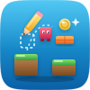</p>
<h1 align="center">Pocket Game Builder</h1>
<p align="center">Make your own small games without writing code — start from a template or an idea, draw levels on a grid, give things looks and behaviours, write rules as sentences, make sound effects — then play right away and share a link anyone can play, with a best-scores table. One Go binary, one SQLite file, one volume. Part of the Pocket apps; works on its own too.</p>
<p align="center">
  <a href="https://github.com/abjelosevic88/pocket-homelab-game-builder/actions"></a>
  <a href="https://github.com/abjelosevic88/pocket-homelab-game-builder/pkgs/container/pocket-homelab-game-builder"></a>
  <a href="LICENSE"></a>
</p>

---

<p align="center">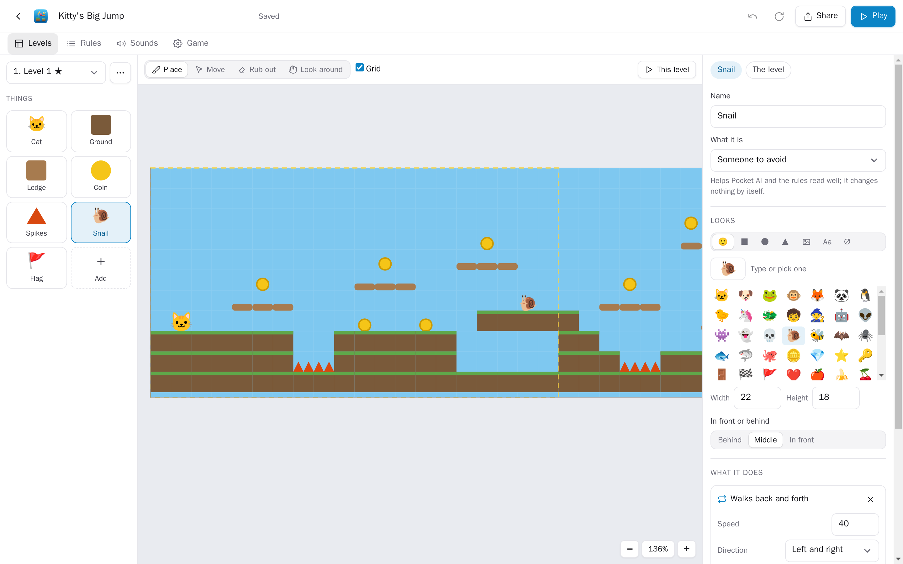</p>

<table>
  <tr>
    <td width="50%">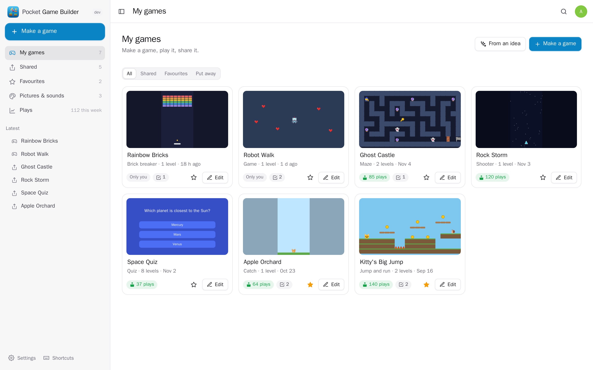</td>
    <td width="50%">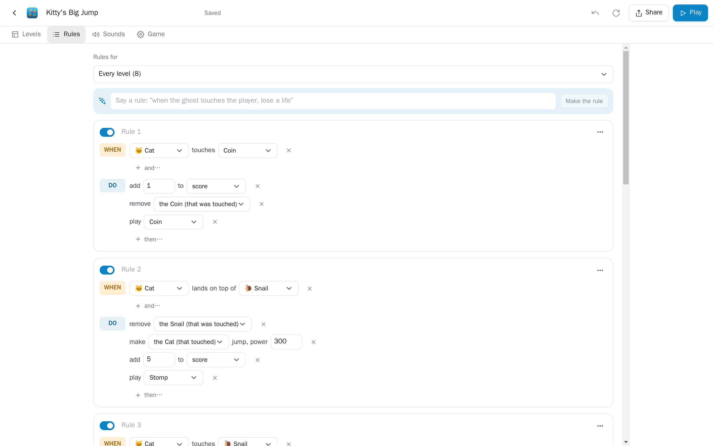</td>
  </tr>
  <tr>
    <td align="center"><sub>Your games, each with a picture of its first level.</sub></td>
    <td align="center"><sub>Rules as sentences: when the cat touches a coin, add 1 to the score and remove the coin.</sub></td>
  </tr>
  <tr>
    <td width="50%">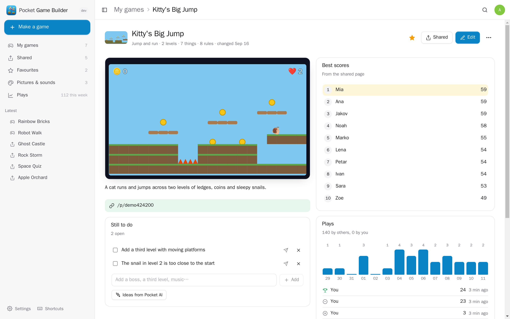</td>
    <td width="50%">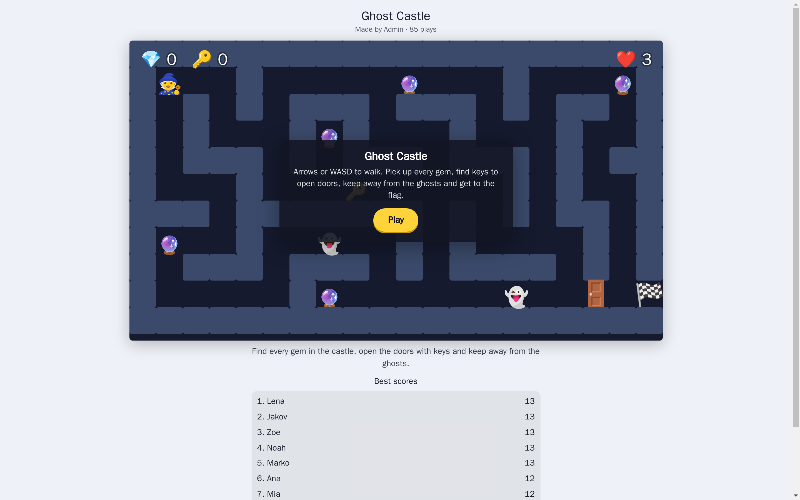</td>
  </tr>
  <tr>
    <td align="center"><sub>A game: play it, best scores, plays, what is still to do, saved copies.</sub></td>
    <td align="center"><sub>The shared page: anyone with the link plays — no account — and can put their name on the table.</sub></td>
  </tr>
  <tr>
    <td width="50%">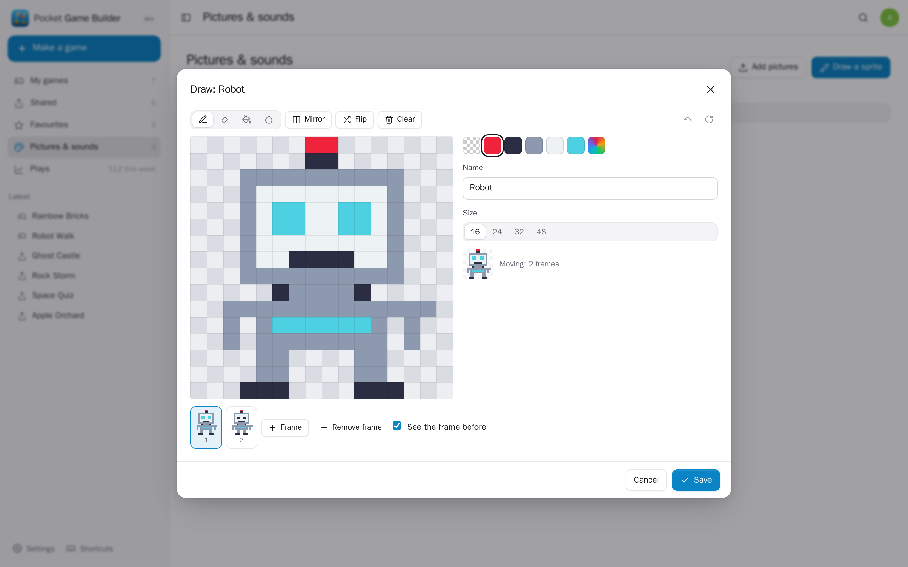</td>
    <td width="50%">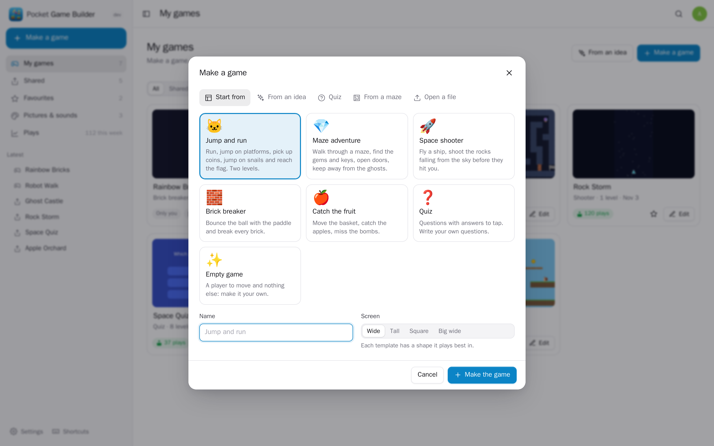</td>
  </tr>
  <tr>
    <td align="center"><sub>Draw sprites pixel by pixel, with frames for an animation.</sub></td>
    <td align="center"><sub>Start from a template, an idea for Pocket AI, a quiz, a maze — or a game file.</sub></td>
  </tr>
</table>

<p align="center">
  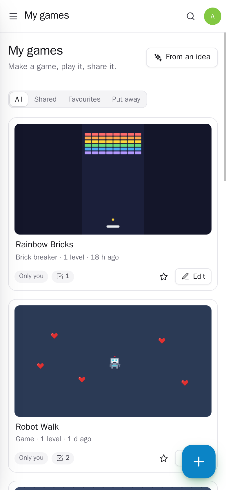
  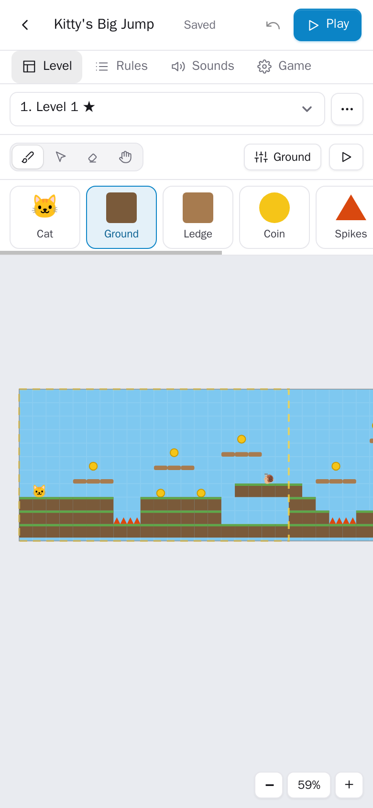
  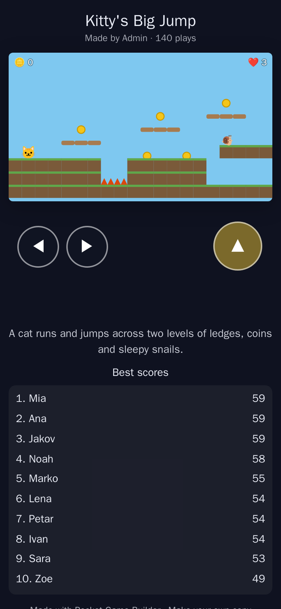
</p>

## What it does

- **Start from a template** — jump and run (two levels, coins, spikes, snails to jump on, a flag), a maze adventure (gems, keys and doors, ghosts that follow you), a space shooter, a brick breaker, catch the fruit, a quiz, or an empty game. Each one plays right away; change anything.
- **From an idea** — tell Pocket AI "a frog who jumps over logs to get home" and it picks the kind of game, draws the levels, names things and writes the words. Also quiz questions on any topic, a rule from a sentence ("when the ghost touches the player, lose a life"), and ideas for what to add next.
- **Levels on a grid** — place things with a click or a drag, move them, rub them out, look around a level bigger than the screen; several levels, each with its own background, picture, music and camera. Undo and redo; it saves as you go.
- **How things look** — emoji, boxes, circles, spikes, words and buttons, or pictures: draw sprites pixel by pixel (frames for an animation, mirror drawing, fill), upload them, or bring them from Pocket Photos, Draw, Photo Lab or Files. A strip of frames animates.
- **What things do** — behaviours with plain settings: runs and jumps, walks around, is a wall, is a ledge, falls, walks back and forth, follows, moves by itself, bounces, slides, shoots, stays in the level, goes round, can be dragged, the camera follows it, floats, spins, disappears.
- **Rules as sentences** — *when* something touches something, lands on top of it, is tapped, leaves the level, a key is pressed, a number reaches a value, how many are left, every few seconds… *do* add to a number, remove it, make something appear, put it back at the start, jump, push, play a sound, say something, shake the screen, go to the next level, win or lose. Numbers (score, lives, keys) show on the screen.
- **Sound** — sound effects made in the app from a kind (coin, jump, laser, explosion…) and sliders, "surprise me", your own sound files, music from Pocket Music, recordings from Pocket Voice.
- **Play anywhere** — keyboard, mouse or touch, with buttons drawn on phone screens; a start screen, win and lose screens with the score.
- **Share** — a link anyone can play on a phone or a computer (no account), a QR code, a best-scores table with names, a version for a frame on any web page, "let people take a copy". The shared version stays put until you share the new one. Or save the game as **one HTML file** that plays anywhere without a server.
- **Keep track** — plays and best scores per game, plays per day, what is still to do, saved copies to go back to, favourites, put away.

## Works with the other Pocket apps

Through [Pocket Core](https://github.com/abjelosevic88/pocket-homelab-core) — sign in once, Pocket AI, and app links that need nothing pasted. Every one is optional: without it the button is greyed out and says why.

| App | What Game Builder does with it |
|---|---|
| Pocket Photos, Draw, Photo Lab | Use a photo, a drawing or an edited picture as a character or a background |
| Pocket Files | Bring pictures, sounds and music in; save a game there as one HTML file |
| Pocket Music, Voice | Music for a level; a recording as a sound |
| Pocket Translate | A copy of a game with every word on the screen in another language |
| Pocket Puzzlecraft | Turn one of your mazes into a maze game to walk through |
| Pocket Chat, Email, Contacts | Send the link to play to a chat, or to people from your address book |
| Pocket Blog, Forum, Family | A draft post with the game's picture, a topic asking what people think, a note on the family board |
| Pocket Calendar | Plan a game night or a play-test, with the link to play |
| Pocket Tasks, Projects, Notes | A game's to-dos as tasks; an issue for a bug; the whole game written down as a note |
| Pocket Alerts | Someone beat the best score; how often your games were played yesterday |

The other way round it offers `gamebuilder:read` (games, plays, best scores, to-dos — for Pocket Day, Search and AI) and `gamebuilder:write` (make a game from a template or an idea, add a to-do), and publishes `gamebuilder.game_made`, `game_shared`, `played` and `best_score`.

## Run it

```sh
docker run -d --name pocket-gamebuilder -p 8080:8080 -v ./data:/data \
  -e BASE_URL=http://gamebuilder.local:8080 -e ADMIN_EMAIL=you@example.com -e ADMIN_PASSWORD=change-me \
  ghcr.io/abjelosevic88/pocket-homelab-game-builder:latest
```

Or [docker-compose.yml](docker-compose.yml), or a release binary (`pocket-gamebuilder`). `make run` starts it with demo games and no login.

- [Configuration](docs/configuration.md) · [API and the game format](docs/api.md) · [Backup](docs/backup.md) · [Reverse proxy](docs/reverse-proxy.md)

## Develop

`make dev` (API on :8080, Vite on :5173), `make test` (go vet, go test, tsc). Go 1.26, React 19, TypeScript, Vite; SQLite through modernc (no CGO). The game engine is plain TypeScript in `web/src/engine` — the same code plays in the editor, on the shared page and in a saved HTML file (built on its own as `dist/play/player.js`); the game format, templates and the game-in-words are in `internal/gamedoc`. `scripts/screenshots.mjs` is a browser smoke test and makes the screenshots.

MIT © 2026 Aleksandar Bjelosevic
